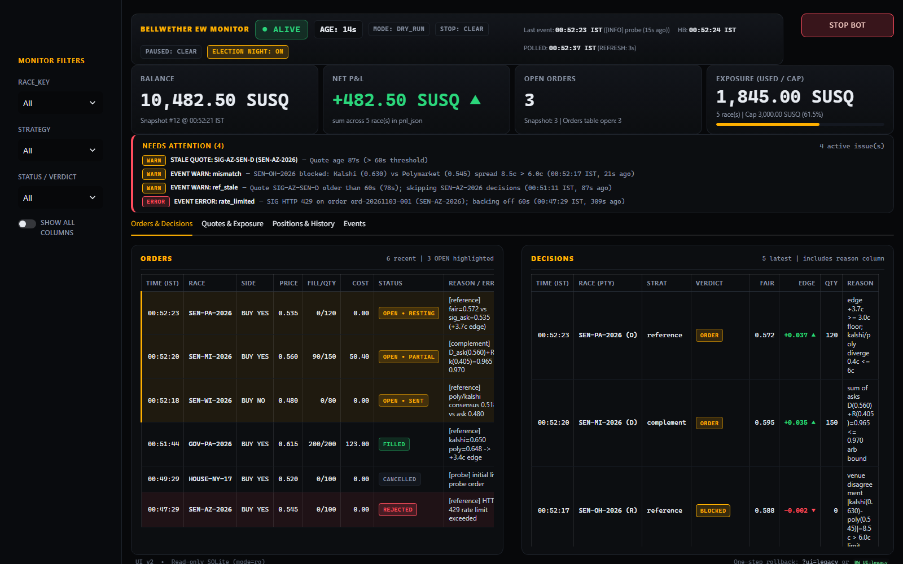
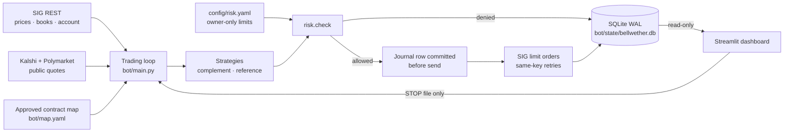
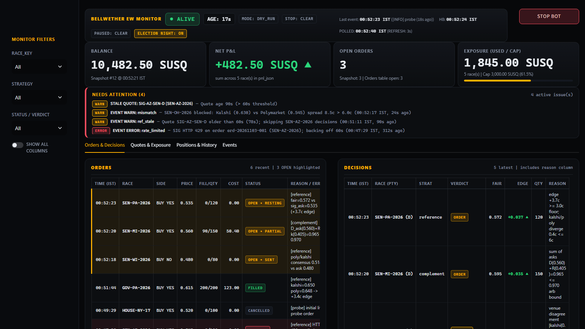
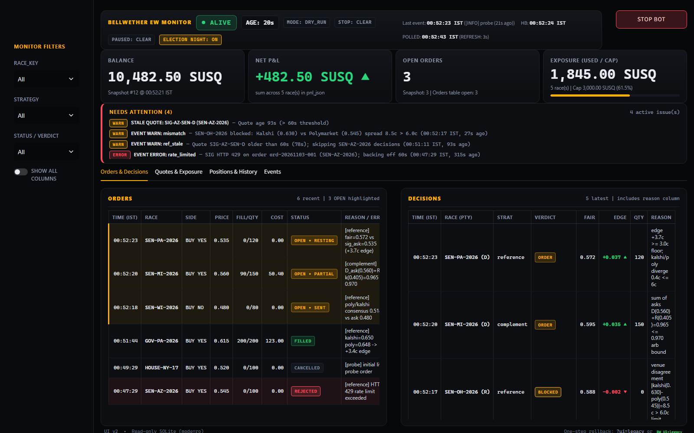
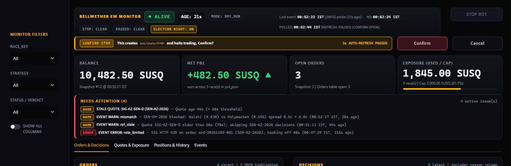
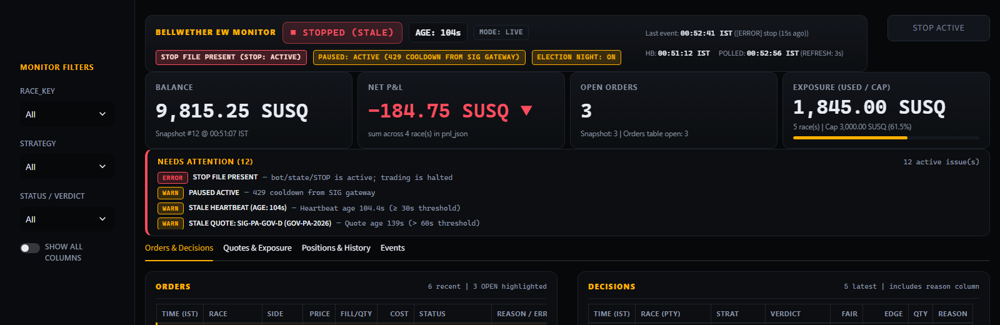

<h1 align="center">Bellwether</h1>

<p align="center"><strong>A risk-gated trading system for prediction markets, built for the SIG Predictions Cup 2026.</strong></p>

<p align="center"><a href="https://github.com/ArnavJain2005/Bellwether/actions/workflows/ci.yml"></a></p>

> **Highlights**
> - **A real-time prediction-market system** that parses every price as an exact
>   decimal and fails closed when it may have missed data.
> - **Risk-gated execution:** one `risk.check` for every order, an idempotency
>   journal written before each send, and a test proving nothing bypasses either.
> - **A live monitoring dashboard** with a confirmation-gated STOP control.

<p align="center">
  
  <br><sub><em>Sample data.</em> The election-week monitor (v2): live status strip, 4 key metrics with exposure bar, derived "Needs attention" problem box, and tabbed inspection of orders, decisions, quotes, positions and events.</sub>
</p>

## The problem

SIG's Predictions Cup runs US midterm election markets: 237 YES/NO contracts across
117 races, traded with simulated funds called SUSQies. Polymarket and Kalshi list many
of the same races with real money behind them.

Bellwether prices SIG's contracts against those two venues and buys on SIG when SIG's
price is out of line. SIG is the only venue it trades on; Polymarket and Kalshi are
read-only references.

**What makes it hard:**
- **Contract equivalence.** Two similarly worded contracts can settle differently, so
  every match needs review.
- **Undocumented behaviour.** The exchange API leaves key behaviour open, such as how
  a NO order's price is quoted and what happens after a timeout.
- **One shared budget.** All keys share 100 reads and 30 writes per minute.
- **Duplicates and position flips.** A bug can mean a duplicate order, or a sell that
  silently becomes a buy of the other side.

## What I built

| Component | What it does | Key files |
| :--- | :--- | :--- |
| **SIG client** | Async REST reads pinned to the tournament, a shared rate limiter, retries with deadlines, and exact `Decimal` wire parsing. Also a realtime WebSocket adapter and feed with revision-gap detection and REST resync, plus a recovery ledger that keeps markets blocked until missed data is accounted for. | [`rest.py`](engine/sig_client/rest.py) · [`rate_limiter.py`](engine/sig_client/rate_limiter.py) · [`realtime_socket.py`](engine/sig_client/realtime_socket.py) · [`recovery.py`](engine/sig_client/recovery.py) |
| **Account state** | Tournament balance, positions, orders, fills, P&L and settlement reads, assembled into a snapshot. Each read records where its data came from, how old it is, and which fields are still unresolved. | [`account_reads.py`](engine/sig_client/account_reads.py) · [`snapshot.py`](engine/account/snapshot.py) |
| **Election-week bot** | A buy-only trading loop with two strategies: complement pricing within a race, and reference pricing against Kalshi and Polymarket. It has one risk gate, an idempotency journal and restart reconciliation, and it runs in dry run by default. | [`main.py`](bot/main.py) · [`strategy.py`](bot/strategy.py) · [`risk.py`](bot/risk.py) · [`orders.py`](bot/orders.py) |
| **Reference prices** | Public Kalshi and Polymarket quotes, with staleness, spread and cross-venue disagreement checks before a fair value is formed. | [`refs.py`](bot/refs.py) |
| **Contract mapping** | Venue discovery and filtering, and a candidate-matching workflow tied to pinned source data. The bot map flags 114 SIG contracts in 57 Senate, governor and chamber-control races as approved for the election-week bot, with 10 races excluded. These bot approvals are separate from formal R1 settlement-equivalence verification. | [`venue_markets/`](data/venue_markets/README.md) · [`r1_mapping/`](data/r1_mapping/README.md) · [`map.yaml`](bot/map.yaml) · [`map_review.md`](bot/map_review.md) |
| **Dashboard** | A Streamlit monitor that opens the bot's SQLite database read-only. Simplified v2 layout with a unified status strip, 4 big numbers, a derived "Needs attention" alert box, 4 detail tabs (Orders & Decisions, Quotes & Exposure, Positions & History, Events), 6-hour IST history, a confirmation-gated STOP control, and legacy layout rollback (`?ui=legacy`). | [`app.py`](dashboard/app.py) · [`db.py`](dashboard/db.py) |
| **Operations** | systemd units and a step-by-step runbook for a single Ubuntu server, plus hosting evidence and the server design. | [`BOT_RUNBOOK.md`](deploy/BOT_RUNBOOK.md) · [`deploy/`](deploy/README.md) |

## Architecture



Every arrow above is code on `main`. The dashboard never imports the bot. It reads the
database read-only and can do one thing: create a `STOP` file that the loop checks on
every pass ([contract](bot/CONTRACT.md)).

## Engineering decisions

- **Decimal everywhere.** JSON numbers are decoded as `Decimal`, and prices are
  stored as decimal strings, so 0.535 never becomes 0.53499…
  ([`wire.py`](engine/sig_client/wire.py), [`limits.py`](bot/limits.py),
  [contract](bot/CONTRACT.md#units)).
- **Journal before send, and retry with the same key.** Each order's row is committed
  with its idempotency key before any bytes leave. Retries rebuild the identical
  request from that row. Any outcome SIG does not confirm becomes `unknown` and pauses
  new orders ([`orders.py`](bot/orders.py)).
- **Buy-only, limit-only, on-tick.** The bot never sells, because an oversized sell
  turns into a buy of the other side. Every order has an explicit limit price, rounded
  down to the 0.005 grid ([`strategy.py`](bot/strategy.py), [`risk.py`](bot/risk.py)).
  NO orders stay off until a probe settles the API's NO-price convention
  ([`probe.py`](bot/probe.py)).
- **Caps count what might be at risk.** Per-order, per-race, total-committed and
  cash-reserve limits include resting orders. Orders with an unknown outcome count at
  full size ([`risk.py`](bot/risk.py)).
- **One gate, enforced by a test.** Only `bot/orders.py` may call the order endpoint,
  and only after `risk.check`. A test fails the build if any other code path reaches it
  ([`test_bypass.py`](bot/tests/test_bypass.py)).
- **File-based controls.** A `PAUSED` file stops new orders until a human removes it,
  and a `STOP` file cancels all orders and exits. Cancelling is never gated by the
  risk check ([`main.py`](bot/main.py), [`sig_writer.py`](bot/sig_writer.py)).
- **Restart reconciliation.** On startup, the bot resolves journal rows a previous run
  left mid-send. In live mode it cancels every open order, then reads balance,
  positions and orders before trading. Anything it cannot explain pauses the bot
  ([`main.py`](bot/main.py)).
- **One rate budget.** Reads and writes share one limiter, and writes are also capped
  per minute in `risk.check`
  ([`rate_limiter.py`](engine/sig_client/rate_limiter.py), [`risk.py`](bot/risk.py)).
- **The key never leaks.** It is read only from the environment and is redacted from
  logs, reprs, errors and stored bodies. Tests enforce this
  ([`config.py`](engine/config.py), [`test_secrets.py`](bot/tests/test_secrets.py)).

<details>
<summary><strong>Screenshot gallery (sample data)</strong></summary>

<br>

**Positions, per-race P&L and 6-hour history (IST)**


**Filters:** one race selected. The filter applies to orders, decisions and positions.


**STOP BOT confirmation:** auto-refresh pauses until the operator confirms or cancels.


**Fault states:** a stale heartbeat, an active STOP file and a pause after rate limiting.


All screenshots come from the repository's sample-database generator
([`sample_db.py`](dashboard/tests/sample_db.py)). The races, balances and orders are
synthetic, and none show real trading.

</details>

## Testing and quality

These counts were measured on `main` at
[`becbbe2`](https://github.com/ArnavJain2005/Bellwether/commit/becbbe262ed050a24d74288f968092f9e61d7c25)
on Nov 4, 2026:

| Suite | Tests | In CI |
| :--- | ---: | :---: |
| Engine (`tests/`) | 2,020 | ✓ |
| Bot (`bot/tests/`) | 386 | ✓ |
| Data and mapping (`data/*/tests/`) | 725 | run separately |
| Dashboard (`dashboard/tests/`) | 34 | run separately (needs Streamlit) |
| **Total** | **3,165** | |

- Every suite passes, and `ruff check .` is clean.
- [GitHub Actions](.github/workflows/ci.yml) runs Ruff and `pytest` on Python 3.11 for
  every push and pull request.
- Pre-commit runs a gitleaks secret scan.
- Tests use recorded SIG fixtures, fakes and synthetic data. They never call the live
  API.

## Tech stack

Python 3.11 · asyncio · httpx · Pydantic v2 · websockets · SQLite (WAL) · PyYAML ·
Streamlit · Altair · pandas · pytest · Ruff · GitHub Actions · systemd

## Run locally

```bash
python -m pip install -e .
python -m ruff check .
python -m pytest
python -m pytest data/venue_markets/tests data/r1_mapping/tests
```

Dashboard on sample data (Streamlit, Altair and pandas are not in `pyproject.toml`).
The generator writes to a temporary directory and prints the two environment variables
to set:

```bash
python -m pip install streamlit altair pandas
python -m pytest dashboard/tests
python -m dashboard.sample_db --mode normal
streamlit run dashboard/app.py
```

The bot's command line:

```bash
python -m bot.main --help
```

`python -m bot.main --dry-run` runs the full loop without sending any order or cancel.
It still reads live SIG prices and public reference quotes. It needs `SUSQ_API_KEY` in
your environment (never commit it), and it shares the account's rate budget. It was not
run for this README.

## Status and roadmap

| Area | Status |
| :--- | :--- |
| SIG read client, realtime feed, recovery ledger, account snapshot | On `main`, tested offline |
| Election-week bot (strategies, risk gate, journal, reconciliation) | On `main`, tested with fakes. [`config/risk.yaml`](config/risk.yaml) is in `dry_run` mode, and NO orders are disabled. |
| Contract map | 114 bot-approved contracts in 57 races; individual House seats are not approved. Formal R1 remains at 0 verified Polymarket matches, 0 verified Kalshi matches, and 237 missing reviewed SIG Info-tab texts. See the [mapping status and criteria](markets/README.md#relationship-to-the-election-week-bot-map-3-nov-2026). |
| Dashboard | On `main`, tested on sample data |
| Engine order path, durable recovery, ₹0 hosting gates | Open. See the [PRD acceptance gates](docs/PRD.md#acceptance-gates) and [open questions](docs/PRD.md#open-questions). |

The bot is a scoped exception for the competition's final days (see
[`CLAUDE.md`](CLAUDE.md)). The longer-term engine roadmap, requirements and acceptance
gates are in the [PRD](docs/PRD.md).

## Results

Results will be added after the competition closes. No P&L, rank, win rate or latency
figures are claimed here.

## About

Built by **Arnav Jain** for the SIG Predictions Cup 2026.

<sub>Audited against `main` at `becbbe2` (PR #65), Nov 4, 2026. SUSQies are simulated competition funds; no real money is traded.</sub>
