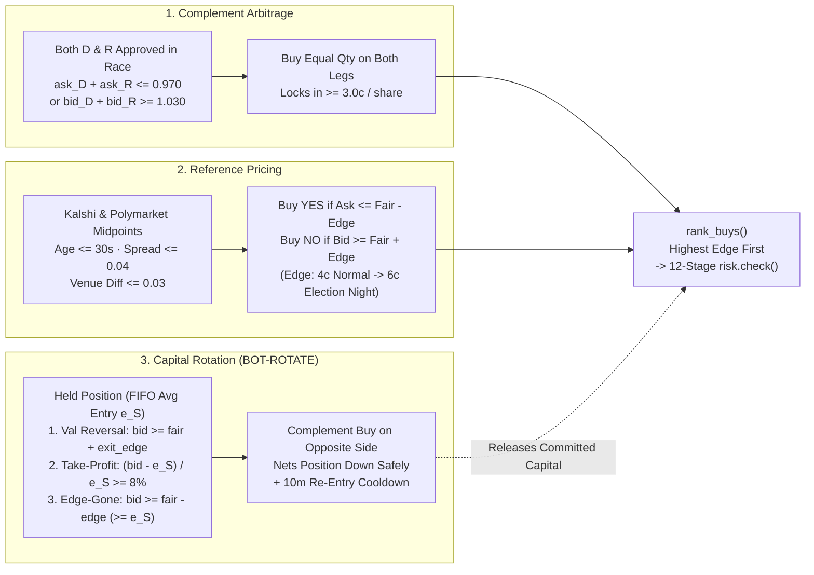
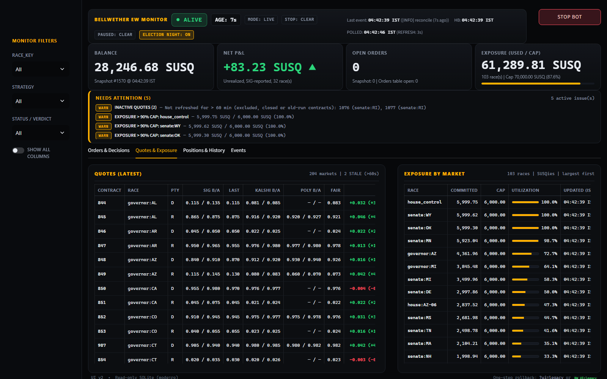
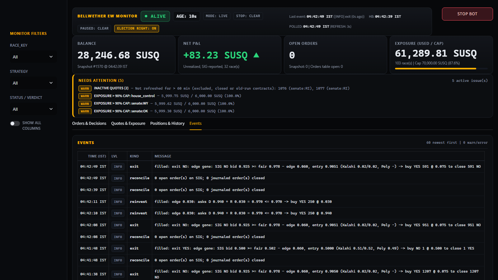

<h1 align="center">Bellwether</h1>

<p align="center"><strong>A risk-gated, real-time quantitative trading system for prediction markets — built for the SIG Predictions Cup 2026.</strong></p>

<p align="center">
  <a href="https://github.com/ArnavJain2005/Bellwether/actions/workflows/ci.yml"></a>
  
  
  
</p>

> **At a Glance (For Recruiters & Technical Reviewers)**
> - **Cross-venue arbitrage & relative-value pricing:** Continuously prices **202 approved SIG contracts across 101 US midterm races** (Senate, Governor, House & Chamber Control) against real-money order books on **Kalshi** and **Polymarket**.
> - **Three coordinated strategies + dynamic capital rotation (`BOT-ROTATE`):** Executes intra-race **complement arbitrage**, cross-venue **reference pricing**, and **reduce-only exits** (take-profit, edge-gone, and valuation reversal) with **highest-edge-first reinvestment**.
> - **Institutional-grade execution safety:** Exact `Decimal` wire parsing (zero IEEE-754 float drift), a **write-ahead SQLite idempotency journal** committed before every network send, **buy-only complement netting** (never sends a sell order that could flip a position), a **12-stage fail-closed risk gate** enforced by an AST bypass test, and a **read-only Streamlit live monitor** with a 2-click emergency `STOP`.

<p align="center">
  
  <br><sub><em>Live election-night run (Nov 4, 2026, IST).</em> Bellwether Monitor v2 operating in <code>LIVE</code> mode across 103 races: real-time heartbeat, SIG-reported unrealized P&amp;L, exposure vs. caps, complement arbitrage fills (<code>governor:CT</code> D+R asks summing to 0.970), and reduce-only rotation exits (<code>governor:HI</code>).</sub>
</p>

---

## Deep-Dive Documentation Index

The main README provides a concise executive overview. For engineers and interviewers who want to inspect the mathematical models, wire protocols, state machines, or operational runbooks in depth, explore these dedicated documents:

| Document | What It Covers |
| :--- | :--- |
| **[`docs/ARCHITECTURE.md`](docs/ARCHITECTURE.md)** | **System Architecture & Execution Lifecycle:** Full 4-subsystem topology, 10-second loop sequence diagram, write-ahead journal state machine, limits ladder progression, WebSocket recovery ledger, and process isolation boundaries. |
| **[`docs/STRATEGIES_AND_RISK.md`](docs/STRATEGIES_AND_RISK.md)** | **Quantitative Strategies, Capital Rotation & Risk Gate:** Mathematical formulation and flowcharts for complement arbitrage, cross-venue fair value, `BOT-ROTATE` take-profit / edge-gone exits, complement-buy netting, and the 12-stage `risk.check` gate. |
| **[`docs/PRD.md`](docs/PRD.md)** | **Product Requirements Document:** Authoritative system specification (`REQ-1` to `REQ-14`), roadmap tracks, and formal acceptance gates (`G-1` to `G-11`). |
| **[`docs/design/order-wire-contracts.md`](docs/design/order-wire-contracts.md)** | **Order Wire Contracts:** SIG REST order placement/cancellation schemas, exact `Decimal` parsing rules, and idempotency semantics. |
| **[`docs/design/account-state-contracts.md`](docs/design/account-state-contracts.md)** | **Account State Contracts:** Portfolio balance, positions, open-order pagination walks, provenance tracking, and HTTP 409 unvalued-holdings handling. |
| **[`docs/design/market-data-recovery.md`](docs/design/market-data-recovery.md)** | **Market Data Recovery:** Realtime WebSocket revision-gap detection, fail-closed market blocking, and REST snapshot resynchronization. |
| **[`bot/map_all_report.md`](bot/map_all_report.md) · [`markets/README.md`](markets/README.md)** | **Contract Equivalence & Mapping:** How 202 SIG contracts across 101 Senate, Governor, House, and Chamber-Control races were verified against Kalshi and Polymarket settlement rules (and why 13 ambiguous/runoff contracts remain excluded). |
| **[`bot/CONTRACT.md`](bot/CONTRACT.md)** | **Bot ↔ Dashboard State Contract:** Binding SQLite WAL schema (`bellwether.db`), decimal/timestamp conventions, and read-only isolation rules. |
| **[`deploy/BOT_RUNBOOK.md`](deploy/BOT_RUNBOOK.md)** | **Production Runbook:** Ubuntu 24.04 `systemd` service units, `botctl.sh` fail-closed launcher, zero-downtime `update_server.sh`, and live probes. |

---

## The Problem

SIG's Predictions Cup runs US midterm election markets: **237 YES/NO contracts across 117 races**, traded with simulated tournament funds (`SUSQies`, 100,000 starting balance). **Kalshi** and **Polymarket** list many of the same races with deep real-money liquidity.

Bellwether continuously compares SIG's order books against Kalshi and Polymarket—as well as internal D vs. R complement pricing within each race—and executes on SIG when prices move out of line. SIG is the only venue Bellwether trades on; Kalshi and Polymarket are strictly read-only reference feeds.

**Why this is a hard systems & quantitative engineering problem:**
1. **Settlement-rule equivalence:** Two similarly titled contracts can settle differently (e.g., Louisiana's runoff calendar vs. swearing-in rules, or Independent candidates). Every mapped contract requires rule verification.
2. **Undocumented exchange edge cases:** The exchange API leaves critical behaviors unspecified—such as how a `NO` order's wire price is denominated (`yes_price` vs. `no_price`), what happens on an HTTP 409 when a holding lacks a valuation price, and whether an order landed after a network timeout.
3. **Strict shared rate budget:** All API keys on the account share **100 reads/min** and **30 writes/min**.
4. **Duplicate orders & position flips:** A naive retry after a timeout can double an order, and an oversized sell order can cross zero and silently open an opposite position.

---

## System Architecture

```mermaid
flowchart TB
  subgraph External["External Venues"]
    SIG["SIG Super Market REST & WS<br/>(Prices · Books · Portfolio · Orders)"]
    Refs["Kalshi & Polymarket Public APIs<br/>(Real-Money Order Books)"]
  end

  subgraph Config["Owner-Controlled Config & Map"]
    Map["bot/map.yaml<br/>202 Approved Contracts (101 Races)"]
    RiskCFG["config/risk.yaml · ladder.yaml · exits.yaml<br/>Caps · Scale · Rotation · Staged Ladder"]
  end

  subgraph Bot["Trading Process (bot/main.py — 10s Async Loop)"]
    Collect["Quote & Account Collector<br/>(engine/sig_client · bot/refs.py)<br/>Exact Decimal Wire · Shared RateLimiter"]
    Exits["Phase 1: Reduce-Only Exits (bot/strategy.py)<br/>Valuation Reversal · Take-Profit (+8%) · Edge-Gone<br/>(Executed as Complement Buys — Never Sells)"]
    Entries["Phase 2: Ranked Entries (bot/strategy.py)<br/>Intra-Race Complement (D+R <= 0.970)<br/>Cross-Venue Reference (Ask <= Fair - Edge)<br/>Sorted Highest-Edge First"]
    Gate["12-Stage Fail-Closed Risk Gate (bot/risk.py)<br/>Caps · 15% Max Race Equity · Cash Reserve · Grid"]
    Journal["Write-Ahead OrderPath (bot/orders.py)<br/>1. Commit 'journaled' Row to SQLite<br/>2. Send POST /orders (Same-Key Retries)<br/>3. On Ambiguity -> Mark 'unknown' & Write PAUSED"]

    Collect --> Exits --> Entries --> Gate
    Gate -->|Allowed| Journal
  end

  subgraph State["Local State Boundary (bot/state/ — CONTRACT.md)"]
    DB[("SQLite WAL<br/>bellwether.db")]
    Files["Control Flags<br/>STOP · PAUSED · LADDER_HOLD"]
  end

  subgraph Monitor["Operator Monitor (dashboard/ — Read-Only)"]
    UI["Streamlit Monitor v2<br/>(SQLite URI mode=ro)<br/>Status Strip · 4 Hero Metrics · 4 Tabs"]
  end

  Refs -->|Public HTTPS| Collect
  SIG <-->|Authenticated HTTPS| Collect
  Journal -->|POST /orders · DELETE /orders| SIG
  Map --> Collect
  RiskCFG --> Gate

  Collect -->|Quotes · Snapshots · Heartbeat| DB
  Gate -->|Blocked Decisions| DB
  Journal -->|Order Lifecycle & Events| DB
  Files -->|Checked Every Loop| Collect

  DB -->|Read-Only (mode=ro)| UI
  UI -.->|2-Click Confirmed<br/>Atomic STOP File Only| Files
```

For the full 10-second loop sequence diagram and state machines (Order Journal, Limits Ladder, and WebSocket Recovery Ledger), see **[`docs/ARCHITECTURE.md`](docs/ARCHITECTURE.md)**.

---

## Quantitative Strategies & Capital Rotation



For the complete mathematical specification and the 12-stage `risk.check` flowchart, see **[`docs/STRATEGIES_AND_RISK.md`](docs/STRATEGIES_AND_RISK.md)**.

---

## What I Built (Component Breakdown)

| Component | What It Does | Key Files |
| :--- | :--- | :--- |
| **SIG Exchange Client** | Async REST reads pinned to the tournament, a shared sliding-window rate limiter (100 reads / 30 writes per min), retries with deadlines, and exact `Decimal` wire parsing. Includes a WebSocket feed with revision-gap detection and a fail-closed recovery ledger. | [`rest.py`](engine/sig_client/rest.py) · [`wire.py`](engine/sig_client/wire.py) · [`rate_limiter.py`](engine/sig_client/rate_limiter.py) · [`realtime_socket.py`](engine/sig_client/realtime_socket.py) · [`recovery.py`](engine/sig_client/recovery.py) |
| **Account State & Provenance** | Tournament balance, positions, paginated open-order walks, fills, P&L, and settlement reads assembled into an immutable snapshot with full provenance and HTTP 409 unvalued-holdings handling. | [`account_reads.py`](engine/sig_client/account_reads.py) · [`snapshot.py`](engine/account/snapshot.py) |
| **Election-Week Bot & Rotation** | Buy-only 10s trading loop running complement arbitrage, reference pricing, and `BOT-ROTATE` reduce-only exits (take-profit, edge-gone, valuation reversal) with highest-edge-first reinvestment, a staged limits ladder (`L0`–`L3`), and restart reconciliation. | [`main.py`](bot/main.py) · [`strategy.py`](bot/strategy.py) · [`exits.py`](bot/exits.py) · [`ladder.py`](bot/ladder.py) · [`risk.py`](bot/risk.py) · [`orders.py`](bot/orders.py) |
| **Reference Price Collector** | Concurrent public Kalshi and Polymarket order-book fetcher with staleness ($\le 30\text{s}$), spread ($\le 0.04$), and cross-venue disagreement ($\le 0.03$) filters. | [`refs.py`](bot/refs.py) · [`refs_check.py`](bot/refs_check.py) |
| **Contract Mapping Pipeline** | Automated venue discovery, candidate matching, and rule verification. Approves **202 SIG contracts across 101 Senate, Governor, House, and Chamber-Control races**, while excluding 11 runoff/ambiguous races. | [`venue_markets/`](data/venue_markets/README.md) · [`r1_mapping/`](data/r1_mapping/README.md) · [`map.yaml`](bot/map.yaml) · [`map_all_report.md`](bot/map_all_report.md) |
| **Live Monitoring Dashboard** | Simplified v2 Streamlit monitor opening `bellwether.db` in strict `mode=ro`. Displays live status strip, 4 hero metrics, derived "Needs attention" alert box, 4 detail tabs, 6-hour IST history chart, confirmation-gated `STOP` button, and `?ui=legacy` rollback. | [`app.py`](dashboard/app.py) · [`db.py`](dashboard/db.py) · [`style.css`](dashboard/style.css) |
| **Production Operations** | `systemd` service units, fail-closed `botctl.sh` operator CLI, zero-downtime `update_server.sh` config-preserving updater, and on-exchange NO-price & exit probes. | [`BOT_RUNBOOK.md`](deploy/BOT_RUNBOOK.md) · [`botctl.sh`](deploy/botctl.sh) · [`update_server.sh`](deploy/update_server.sh) · [`probe.py`](bot/probe.py) · [`exit_probe.py`](bot/exit_probe.py) |

---

## Key Engineering Decisions

- **`Decimal` everywhere — zero float drift.** JSON numbers are decoded directly into `Decimal`, and prices/costs are stored in SQLite as exact decimal strings, so `0.535` never becomes `0.5349999999999999` ([`wire.py`](engine/sig_client/wire.py), [`limits.py`](bot/limits.py), [`CONTRACT.md`](bot/CONTRACT.md#units)).
- **Write-ahead idempotency journal before network send.** Every order row is committed to SQLite with its deterministic idempotency key (`status='journaled'`) before any bytes leave the socket. Retries rebuild the identical request from that row. Any outcome SIG does not confirm becomes `unknown` and immediately pauses new trading ([`orders.py`](bot/orders.py)).
- **Buy-only execution & complement-buy exits.** The bot never sends `action="sell"`, eliminating the risk that an oversized or retried sell flips into a short position. Reduce-only exits buy the opposite complement side (`NO` buy to close `YES`; `YES` buy to close `NO`), verified against SIG's clearing rules via [`exit_probe.py`](bot/exit_probe.py) ([`exits.py`](bot/exits.py), [`strategy.py`](bot/strategy.py)).
- **Worst-case commitment accounting.** Per-order, per-race, 15% max-race-equity, total-committed, target-deployment, and minimum-cash-reserve checks include resting open orders and count any `unknown` order at 100% of its full notional cost ([`risk.py`](bot/risk.py)).
- **Single risk gate, enforced by an AST test.** Only `bot/orders.py` may call the order placement endpoint, and only after `risk.check` or `risk.check_exit` passes. [`test_bypass.py`](bot/tests/test_bypass.py) inspects the AST across the repository and fails CI if any other code path can reach order placement.
- **Staged limits ladder with health gates.** [`ladder.py`](bot/ladder.py) steps exposure caps up (`L0` $\to$ `L1` $\to$ `L2` $\to$ `L3`) only when wall-clock schedule, minimum fill count, and an uninterrupted error-free window (`clean_minutes`) all pass.
- **Zero-trust secret redaction.** `SUSQ_API_KEY` is read only from the environment and scrubbed from logs, exception tracebacks, `repr` strings, and database columns, enforced by [`test_secrets.py`](bot/tests/test_secrets.py) and `gitleaks`.

---

## Live & Fault-State Screenshot Gallery

<details open>
<summary><strong>Click to expand/collapse screenshots (5 live election-night views + 2 synthetic fault/control states)</strong></summary>

<br>

### 1. Live Quotes & Cross-Venue Exposure (`Quotes & Exposure` Tab — Live Run)
Real-time SIG bid/ask vs. Kalshi and Polymarket order books across **204 contracts**, paired with per-race utilization bars across **103 active races**.


<br>

### 2. Live Positions, Per-Race Unrealized P&L & 6-Hour History (`Positions & History` Tab — Live Run)
45 open SIG positions mapped to their races with market value and unrealized P&L, per-race P&L breakdown, and the 6-hour IST trajectory showing the live capital deployment step-up.


<br>

### 3. Live Rotation Exits, Reinvestments & Reconciliations (`Events` Tab — Live Run)
Audit trail showing live `edge gone` complement-buy exits closing positions above entry price, followed by immediate `reinvest` fills into `governor:CT` complement arbitrage and `0 open order(s)` reconciliations.


<br>

### 4. Interactive Race Filtering (`governor:CT` Selected — Live Run)
Filtering the live monitor from the sidebar to inspect `governor:CT`: 6 filled complement arbitrage legs (`BUY YES 0.030 + BUY YES 0.940 = 0.970`) and live exit evaluation.


<br>

### 5. Two-Step `STOP BOT` Confirmation Modal (Sample Data)
Clicking `STOP BOT` pauses auto-refresh and requires explicit operator confirmation before atomically creating `bot/state/STOP`.


<br>

### 6. Fault States: Stale Heartbeat, Active `STOP` & `PAUSED` Indicators (Sample Data)
Synthetic fault injection (`dashboard/sample_db.py --mode stale`) demonstrating how the monitor surfaces a stale heartbeat (`■ STOPPED (STALE)`), active `STOP` and `PAUSED` control files, and rate-limit warnings.


</details>

---

## Testing & Quality

Measured on `main` at [`3426c77`](https://github.com/ArnavJain2005/Bellwether/commit/3426c77) (Nov 4, 2026):

| Suite | Tests | In CI | What It Verifies |
| :--- | ---: | :---: | :--- |
| **Engine (`tests/`)** | 2,020 | ✓ | SIG REST/WebSocket wire parsing, rate limiter, account snapshots, revision-gap recovery ledger |
| **Bot (`bot/tests/`)** | 413 | ✓ | Complement/reference/rotation strategies, 12-stage risk gate, AST bypass check, journal reconciliation, `botctl`, secret redaction |
| **Data & Mapping (`data/*/tests/`)** | 725 | run separately | Kalshi/Polymarket transport, per-district House admission, R1 candidate matching & schema validation |
| **Dashboard (`dashboard/tests/`)** | 43 | run separately (needs Streamlit) | Read-only SQLite URI enforcement, SIG live snapshot parsing, derived P&L, `STOP` file atomic creation, `AppTest` UI rendering |
| **Total** | **3,201** | | **100% passing · `ruff check .` clean · `gitleaks` pre-commit clean** |

---

## Tech Stack

`Python 3.11+` · `asyncio` · `httpx` · `Pydantic v2` · `websockets` · `SQLite (WAL)` · `PyYAML` · `Streamlit` · `Altair` · `pandas` · `pytest` · `Ruff` · `GitHub Actions` · `systemd`

---

## Run Locally

```bash
# 1. Install core package and run linter + core test suites
python -m pip install -e .
python -m ruff check .
python -m pytest
python -m pytest data/venue_markets/tests data/r1_mapping/tests
```

```bash
# 2. Run the dashboard test suite & launch on synthetic sample data
python -m pip install streamlit altair pandas
python -m pytest dashboard/tests
python -m dashboard.sample_db --mode normal
streamlit run dashboard/app.py
```

```bash
# 3. Inspect bot CLI & check live public reference quotes (no SIG key required)
python -m bot.main --help
python -m bot.refs_check
```

For full server deployment, `systemd` setup, SSH port-forwarding, and live operator procedures, see **[`deploy/BOT_RUNBOOK.md`](deploy/BOT_RUNBOOK.md)**.

---

## About

Designed and built by **Arnav Jain** for the **SIG Predictions Cup 2026**.

<sub>Audited against `main` at `3426c77` (PR #70), Nov 4, 2026. `SUSQies` are simulated tournament funds on SIG's Super Market competition platform; no real money is traded on SIG.</sub>
