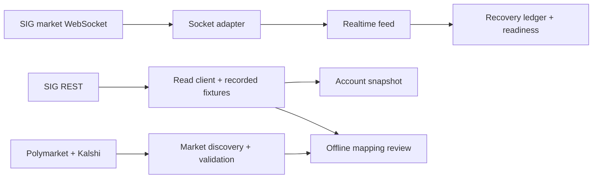
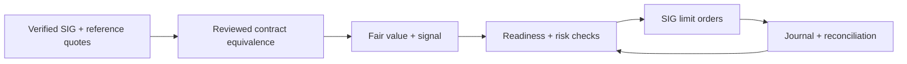

<h1 align="center">Bellwether</h1>

<p align="center"><strong>A prediction-market trading system under development for the SIG Predictions Cup 2026</strong></p>

<p align="center">Market data · Contract equivalence · Recovery engineering · Risk-aware execution design</p>

<p align="center"><a href="https://github.com/ArnavJain2005/Bellwether/actions/workflows/ci.yml"></a></p>

<p align="center"><strong>Current state: read-only foundations and offline validation. Trading is not activated.</strong></p>

<p align="center"><a href="#what-exists-today">What exists</a> · <a href="#architecture">Architecture</a> · <a href="#evidence-and-limits">Evidence</a> · <a href="#roadmap">Roadmap</a> · <a href="#run-locally">Run locally</a></p>

Bellwether is being built to identify potential mispricings in SIG's simulated-funds US midterm election markets. SIG is the **only intended execution venue**; Polymarket and Kalshi supply **reference-market data**, not accounts or trades. The engineering goal is a defensible chain from contract equivalence and fresh prices to a reasoned signal, an engine-enforced risk check and, eventually, a limit order. The project also serves as a quant and systems engineering case study: correctness, provenance and measurable failure behavior matter more than an unverified backtest or a claimed return.

> [!IMPORTANT]
> The repository has **no strategy, fair-value engine, order placement, risk check, operational pause/restart controller or runnable trading service**. No acceptance gate authorizes live SIG trading. Its market-data and account components have offline tests, but the end-to-end system has not been demonstrated against live SIG. See the [authoritative PRD](docs/PRD.md) for requirements and gate definitions.

## At a glance

| Scope | Verified repository state |
| :--- | :--- |
| Competition | SIG Predictions Cup 2026; simulated SUSQies only. A recorded SIG inventory contains **237 contracts** and yields **117 proposed race keys**. These are a snapshot and title-derived proposals, not verified current coverage or authoritative race IDs. |
| Data sources | Read-only SIG REST client and market-data WebSocket adapter; Polymarket/Kalshi election-market discovery pipeline. |
| Contract mapping | Offline, provenance-pinned review workflow. **0/237** SIG contracts have an authoritative race identity or reviewed Info-tab text; **0** verified counterparts on either venue; **0** fair-value-eligible contracts. [Coverage report](markets/R1_REPORT.md). |
| Execution | No order writer, active risk policy, strategy or live/paper trading loop. |
| Quality | Offline tests, recorded SIG fixtures, fake transports, Ruff and [CI](.github/workflows/ci.yml). The latest audited `main` CI run [passed](https://github.com/ArnavJain2005/Bellwether/actions/runs/40740802674). |

*Repository snapshot: `main` at [`278de70`](https://github.com/ArnavJain2005/Bellwether/commit/278de70eeba113020e0a0b579e577f1d00091a13), audited October 28, 2026. Open work is not included in the implemented column, for example [PR #42](https://github.com/ArnavJain2005/Bellwether/pull/42) (lifecycle sweep) and [PR #44](https://github.com/ArnavJain2005/Bellwether/pull/44) (venue filter fix).*

## What exists today

| Area | Implemented on `main` | Boundary that still matters |
| :--- | :--- | :--- |
| **SIG reads** | Tournament, markets, prices, orderbooks, trades, open orders and tournament account reads through [`SigRestClient`](engine/sig_client/rest.py) and [`account_reads.py`](engine/sig_client/account_reads.py). Exact `Decimal` wire parsing, explicit tournament scope where supported, deadlines, retries and a shared rate limiter. | Account cash, wire quantity units and some price meanings remain unresolved; [`O1`](docs/design/order-wire-contracts.md) records evidence and open questions, not settled behavior. |
| **Market feed** | [`RealtimeSocketTransport`](engine/sig_client/realtime_socket.py) implements a market-only Supabase WebSocket transport. The [feed](engine/sig_client/realtime.py) handles token refresh, revision gaps and REST book resync; the [ledger](engine/sig_client/recovery.py) tracks blockers and missed windows. | Tested offline; a socket join or book resync cannot clear a settlement/trade blocker. Production bootstrap, durable recovery and blocker clearing are absent, so production markets do not become ready. |
| **Account snapshot** | [`AccountSnapshot`](engine/account/snapshot.py) assembles A2 reads with provenance, component outcomes, timing, scope findings and unresolved fields. | Separate reads are not atomic. The snapshot does **not** establish spendable cash, equity or trading readiness. |
| **Reference discovery** | [`data/venue_markets/`](data/venue_markets/README.md) fetches and validates relevant Polymarket/Kalshi market lists, including rules-based House eligibility checks. | A market list is not a current quote feed, complete coverage guarantee or settlement-equivalent mapping. Open [PR #44](https://github.com/ArnavJain2005/Bellwether/pull/44) proposes excluding state-legislative House markets (for example Kalshi `KXTXHOUSE`) that the current filter can admit as federal House references. |
| **Mapping review** | [`data/r1_mapping/`](data/r1_mapping/README.md) audits a complete recorded SIG pagination walk, produces candidate suggestions, validates reviewer decisions and regenerates a coverage/missing-input report. | All 237 venue decisions remain unresolved; the frozen venue snapshot is incomplete and fails the current validator. Suggestions cannot become fair values without reviewed rules and identity evidence. |
| **Operational design** | [Hosting evidence and dry-run runbook](deploy/README.md), [market recovery design](docs/design/market-data-recovery.md), [account contracts](docs/design/account-state-contracts.md) and [order-wire evidence](docs/design/order-wire-contracts.md). | These are design/evidence artifacts. No server, deployment launcher, trade journal or order path exists. |

### Architecture

The solid paths below describe **implemented read and review components**. They are separate foundations, not a running end-to-end trading loop.



The **target system** has a separate decision and execution path. The blocks below are planned; the arrows do not imply those connections exist today.



**Why the separation matters:** a similarly worded election contract can settle differently; a fresh book does not prove that an unsequenced settlement was observed; and a snapshot assembled from several endpoints does not prove account-wide atomicity. Each uncertainty blocks the corresponding claim or decision rather than being silently filled in.

## Evidence and limits

The implementation is designed around explicit evidence and failure states. Its current tests demonstrate **offline behavior**, not trading performance or production readiness.

| Engineering choice | Evidence you can inspect |
| :--- | :--- |
| Exact numeric ingestion | REST [wire models](engine/sig_client/wire.py) and [WebSocket decoder](engine/sig_client/realtime_socket.py) retain JSON numeric values as `Decimal`/integer rather than converting them through binary floats. |
| Conservative market recovery | [Recovery ledger](engine/sig_client/recovery.py), [readiness model](engine/sig_client/readiness.py) and [design/acceptance tests](docs/design/market-data-recovery.md) preserve blockers across feed replacement in one process and distinguish book evidence from lifecycle/trade evidence. The ledger is not durable across process restart. |
| Auditable account observations | [A3 snapshot](engine/account/snapshot.py) reports each read's outcome, temporal span and unresolved meaning; it does not label a cross-endpoint view `READY`. |
| Reproducible mapping review | [Pinned source hashes](markets/r1_sources.json), [decisions](markets/r1_mapping.json) and [generated report](markets/R1_REPORT.md). The validator refuses unsupported verified matches and fair-value eligibility. |

<details>
<summary><strong>Explore the mapping evidence: why 237 contracts are still unresolved</strong></summary>

The recorded walk has three pages (100 + 100 + 37) and was complete **when captured**. Its titles generate 117 race-key proposals. They do not provide authoritative race/stage IDs, regular-versus-special status or SIG Info-tab resolution clauses. The available frozen venue dump is incomplete and predates later filter repairs. Candidate suggestions are therefore leads for human review, never confirmed matches or a proof of absence. The [report](markets/R1_REPORT.md) enumerates missing evidence per market; the [review protocol](markets/README.md) specifies settlement-equivalence criteria.

</details>

<details>
<summary><strong>Explore the safety boundary: what a green CI run does not prove</strong></summary>

The suite uses recorded fixtures, synthetic data and fake transports. It has not established full live SIG WebSocket interoperability, resolution equivalence, a correct write-side API contract, outage cancellation, durable restart recovery or an unattended cloud soak. The [PRD acceptance gates](docs/PRD.md#acceptance-gates) remain unmet. [PR #42](https://github.com/ArnavJain2005/Bellwether/pull/42) proposes an opt-in lifecycle sweep, and [PR #44](https://github.com/ArnavJain2005/Bellwether/pull/44) proposes a venue-filter fix. Both are still under review; neither is a merged capability.

</details>

## Roadmap

Progress depends on [G-1 through G-11](docs/PRD.md#acceptance-gates), with recorded evidence required at each gate. The tracks can advance independently where their dependencies allow.

| Step | Deliverable and acceptance focus | State |
| :--- | :--- | :--- |
| **1. Establish inputs** | Reviewed SIG-to-venue equivalence, authoritative race/group identity and fresh comparable quotes; complete market-data recovery rules. | Mapping workflow and socket adapter built; approvals, quote collectors and blocker clearing pending. |
| **2. Prove the decision path** | Reference collectors, SQLite storage, fair value and explainable shadow signals; test candidate strategies without sending orders. | Planned; no backtest or alpha result claimed. |
| **3. Build protected execution** | Resolve order-wire questions; journal idempotency keys before send; enforce limit-only orders, pending exposure, risk checks and bypass tests. The [O1 evidence note](docs/design/order-wire-contracts.md) is a draft under review. O1-F1 corrected its Arnav-only check runbook: retries now depend on the response code, and cancel-all requires a complete, scoped inventory of open orders. None of its real-platform checks has been run, and the expiry check observes only whether an expiry is accepted, so G-4 stays blocked. O2 implementation pending. |
| **4. Recover and control** | Tournament-scoped restart reconciliation, pauses, protective cancellation, loss reset and terminal controls; verify resting-order outage bounds. | Designs only; G-2 through G-8 not met. |
| **5. Operate, then decide** | Verify ₹0 hosting, run an unattended cloud **dry-run** and reboot/fault exercises; consider a limited SIG pilot only after all gates pass and Arnav explicitly activates it. | [H1 design/runbook](deploy/README.md) written; G-9/G-10/G-11 not met. |
| **6. Present and evaluate** | A simple, responsive monitoring dashboard after terminal controls; later analyze calibration, repricing lag, fill quality, risk blocks and uptime from actual logs. | Planned; no dashboard or performance results exist. |

<details>
<summary><strong>View proposed pilot limits and open policy questions</strong></summary>

The competition starts with **100,000 SUSQies**. The following are *provisional ceilings*, not activated configuration: **500** per order, **2,000** per race, **3,000** per related group, **10,000** total commitment including pending/unresolved orders, **90,000** minimum uncommitted reserve and a **2,000** loss trigger below the eventual baseline. Commitment, group boundaries, tournament cash and equity valuation still require decisions and evidence. No `config/risk.yaml` exists and nothing enforces these figures. A loss trigger is not a guarantee of maximum loss. See the [PRD](docs/PRD.md#provisional-pilot-ceilings).

</details>

## Run locally

Python **3.11+**. The repository's [CI workflow](.github/workflows/ci.yml) uses Python 3.11 and runs install, Ruff and the default test suite:

```bash
python -m pip install -e .
python -m ruff check .
python -m pytest
```

The default `pytest` configuration targets `tests/`. Run the additional offline data suites explicitly:

```bash
python -m pytest data/venue_markets/tests data/r1_mapping/tests
python -m data.r1_mapping inventory
python -m data.r1_mapping validate
python -m data.r1_mapping report --check
```

The offline mapping commands require only committed source files. Candidate regeneration additionally needs the **exact hash-pinned, git-ignored venue snapshot** named in [`r1_sources.json`](markets/r1_sources.json); see the [workflow instructions](data/r1_mapping/README.md). There is **no engine start/trade command**. Live SIG capture is reserved for Arnav; development uses fixtures and fake transports. Never commit a key or `.env`.

## Project guide

| Read this | For |
| :--- | :--- |
| [PRD](docs/PRD.md) | Authoritative requirements, scope, roadmap, acceptance gates and open decisions. |
| [Market recovery](docs/design/market-data-recovery.md) · [account state](docs/design/account-state-contracts.md) · [order contracts](docs/design/order-wire-contracts.md) | Design reasoning and unresolved platform behavior. |
| [Mapping workflow](data/r1_mapping/README.md) · [review records](markets/README.md) · [coverage report](markets/R1_REPORT.md) | Reproduce the candidate and review process, and see what evidence is missing. |
| [Deployment preparation](deploy/README.md) | Hosting questions, proposed server design and future dry-run runbook. |
| [Contributor rules](CLAUDE.md) · [agent rules](AGENTS.md) | Ownership, testing and safety boundaries. Some older status paragraphs lag current `main`; use this README and the actual code for implementation status, and the PRD for policy. |

Bellwether is a work in progress. Its present contribution is a tested, inspectable foundation for market ingestion, evidence-led mapping and fail-closed state handling; measured trading outcomes will require the later decision, execution and deployment stages.
