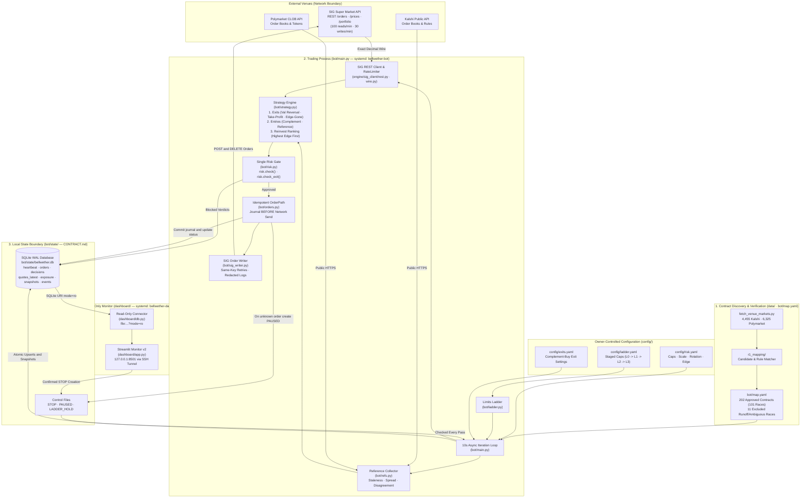
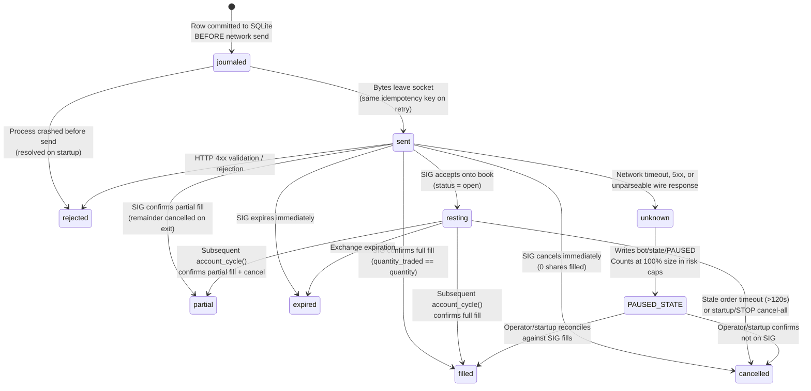
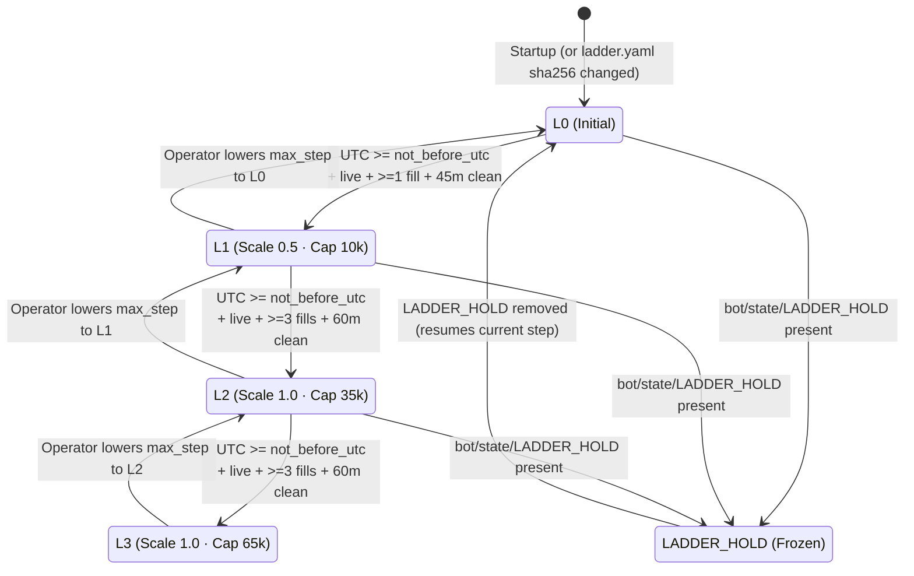
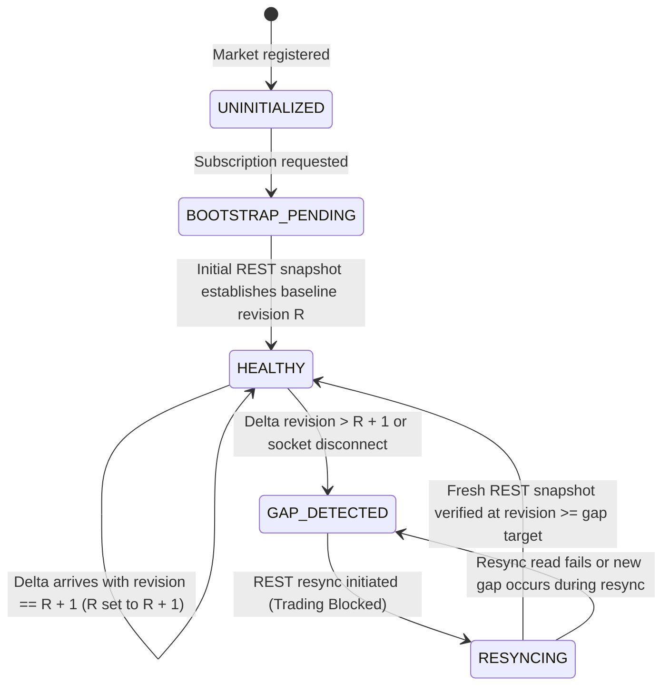

# Bellwether — System Architecture & Execution Lifecycle

> **Scope:** Deep-dive reference for engineers and technical reviewers covering the end-to-end topology, the 10-second asynchronous trading loop, the write-ahead idempotency journal, the market-data recovery ledger, and the strict process isolation boundary between the trading bot and the monitoring dashboard.

**Related specifications:**
- [Main README](../README.md) · [Quantitative Strategies & Risk Gate](STRATEGIES_AND_RISK.md)
- [Product Requirements Document (`docs/PRD.md`)](PRD.md) · [Binding Bot/Dashboard Contract (`bot/CONTRACT.md`)](../bot/CONTRACT.md)
- [Order Wire Contracts (`docs/design/order-wire-contracts.md`)](design/order-wire-contracts.md) · [Account State Contracts (`docs/design/account-state-contracts.md`)](design/account-state-contracts.md) · [Market Data Recovery (`docs/design/market-data-recovery.md`)](design/market-data-recovery.md)

---

## 1. High-Level System Topology

Bellwether is structured into four strictly separated subsystems:
1. **Offline Discovery & Contract Equivalence Pipeline (`data/`, `markets/`, `bot/map.yaml`)** — Fetches open markets from Kalshi and Polymarket, validates settlement rules against SIG's 237 US midterm election contracts, and produces an owner-approved mapping of **202 contracts across 101 races**.
2. **SIG Exchange Client & Engine Primitives (`engine/sig_client/`, `engine/account/`)** — Provides exact `Decimal` wire parsing (`wire.py`), a shared sliding-window rate limiter (`rate_limiter.py`: 100 reads/min, 30 writes/min), async REST reads (`rest.py`, `account_reads.py`), a WebSocket feed with revision-gap detection (`realtime_socket.py`, `realtime_feed.py`), and a fail-closed recovery ledger (`recovery.py`).
3. **Election-Week Trading & Capital Rotation Loop (`bot/`)** — Runs the 10-second trading pass (`main.py`), collects public reference quotes (`refs.py`), evaluates exit and entry strategies (`strategy.py`, `exits.py`), enforces the 12-stage risk gate (`risk.py`) and staged limits ladder (`ladder.py`), and executes orders through a write-ahead SQLite idempotency journal (`orders.py`, `sig_writer.py`).
4. **Read-Only Operator Monitor (`dashboard/`)** — A Streamlit UI (`app.py`, `db.py`) that opens `bot/state/bellwether.db` via a `mode=ro` URI, never imports `bot/` or `engine/`, makes zero network calls, and interacts with the bot exclusively by atomically creating `bot/state/STOP`.

---

## 2. The 10-Second Trading Loop (`bot/main.py`)

Every iteration of `Bot.iteration()` executes a deterministic sequence designed to prioritize safety controls, close profitable or stale holdings before opening new exposure, and keep within SIG's shared rate budget.

```mermaid
sequenceDiagram
  autonumber
  participant FS as Control Files (STOP / PAUSED / LADDER_HOLD)
  participant Bot as Bot Loop (bot/main.py)
  participant SIG as SIG REST API (engine/sig_client)
  participant Refs as Kalshi and Polymarket (bot/refs.py)
  participant Strat as Strategy and Rotation (bot/strategy.py)
  participant Risk as Risk Gate (bot/risk.py)
  participant Journal as OrderPath and SQLite (bot/orders.py)

  Bot->>FS: Check bot/state/STOP
  alt STOP file exists or signal received
    Bot->>SIG: POST /orders/cancel-all (if live)
    Bot->>Journal: Record stop event and final heartbeat
    Bot-->>Bot: Exit 0 (systemd does not restart)
  end

  Bot->>Journal: Evaluate Limits Ladder (L0 to L3)
  alt Every 60s (Account & Snapshot Cycle)
    Bot->>SIG: GET /tournaments/{slug} (balance)
    Bot->>SIG: GET /tournaments/{slug}/portfolio/positions
    Bot->>SIG: Walk GET /orders?status=open
    Bot->>Journal: Refresh resting order statuses & reconcile positions
    Bot->>Journal: Cancel stale orders (> order_expiry_seconds)
    Bot->>Journal: Insert 60s snapshot & per-race exposure
  end

  Bot->>Refs: Fetch Kalshi and Polymarket order books (concurrent)
  Bot->>SIG: GET /exchanges/prices (chunks of 50)
  Bot->>Journal: Upsert quotes_latest for all 202 contracts

  rect rgb(22, 36, 32)
    Note over Bot,Journal: Phase 1: Reduce-Only Exits (Before Buys)
    alt config/exits.yaml enabled == true and not PAUSED/LADDER_HOLD
      Bot->>Strat: evaluate_exit() per held contract (Val Reversal / Take-Profit / Edge-Gone)
      loop Each Exit Candidate
        Bot->>SIG: Fresh positions & order book read
        Bot->>Risk: risk.check_exit() (held qty, live exits, grid, rate budget)
        alt Approved
          Bot->>Journal: Commit journaled row (action=buy, complement exit)
          Bot->>SIG: POST /orders (complement buy that nets against holding)
          Bot->>SIG: Immediately cancel any unfilled remainder
          Bot->>Journal: Update row (filled, partial, cancelled, unknown) and log exit event
        end
      end
    end
  end

  rect rgb(24, 30, 44)
    Note over Bot,Journal: Phase 2: Ranked Entries & Reinvestment
    Bot->>Strat: evaluate_complement() & evaluate_reference() across all races
    Strat->>Strat: rank_buys() — Sort candidates by highest edge first
    loop Each Ranked Buy Candidate (while free cash > 2% of balance)
      Bot->>SIG: Read exchange order book depth (if read budget allows)
      Bot->>Risk: risk.check() (12-stage gate: caps, 15% race fraction, reserve, cooldown)
      alt Verdict == ALLOWED
        Bot->>Journal: Commit journaled row with deterministic idempotency key
        Bot->>SIG: POST /orders (same-key retry on transient errors)
        Bot->>Journal: Record final status and reinvest event
      else Verdict == DENIED
        Bot->>Journal: Append 'blocked' decision with exact reason
      end
    end
  end

  Bot->>Journal: Rewrite single-row heartbeat (id=1) with loop_ms, rate counts and caps
```

---

## 3. State Machines

### 3.1 Order Idempotency Journal (`bot/orders.py`)

To prevent duplicate orders across network timeouts or process crashes, **every order is committed to SQLite with status `journaled` before a single byte is sent over the network**. If a request times out or returns a 5xx/network error, the bot never guesses whether the order landed: it marks the order `unknown` and creates `bot/state/PAUSED`, which blocks all new orders until reconciled.

### 3.2 Staged Limits Ladder (`bot/ladder.py` & `config/ladder.yaml`)

When `config/ladder.yaml` is active, the bot starts conservatively at `L0` and only steps up to `L1`, `L2`, and `L3` when all four gates pass simultaneously: wall-clock schedule (`not_before_utc`), live mode active (`require_live`), minimum fill count (`min_fills`), and an uninterrupted error-free window (`clean_minutes` with zero error events, reconciliation mismatches, or `unknown` orders).

### 3.3 Realtime Market-Data Recovery Ledger (`engine/sig_client/recovery.py`)

For high-frequency WebSocket feeds (`engine/sig_client/realtime_feed.py`), every market maintains an independent state machine in the recovery ledger. Any revision gap, malformed frame, or socket disconnect immediately transitions affected markets to a blocked state (`GAP_DETECTED` / `RESYNCING`) until a fresh REST snapshot at revision $\ge$ the gap is verified.

---

## 4. Process Isolation & Security Architecture

| Boundary Rule | Implementation | Verification |
| :--- | :--- | :--- |
| **Single Order Entry Point** | Only [`bot/orders.py`](../bot/orders.py) (`OrderPath.place` and `OrderPath.place_exit`) may invoke `SigWriter.place_order`, and only after `risk.check` or `risk.check_exit` returns `allowed=True`. | Enforced in CI by AST inspection in [`bot/tests/test_bypass.py`](../bot/tests/test_bypass.py). |
| **Secret Redaction** | `SUSQ_API_KEY` is read exclusively from environment variables (`/etc/bellwether.env`), wrapped in a secret string type, and scrubbed from exceptions, logs, reprs, and SQLite error columns. | Enforced by [`bot/tests/test_secrets.py`](../bot/tests/test_secrets.py) and pre-commit `gitleaks`. |
| **Dashboard Read-Only Isolation** | [`dashboard/db.py`](../dashboard/db.py) opens SQLite via `file:.../bellwether.db?mode=ro`. It never imports `bot/` or `engine/`, never reads `.env`, and makes zero network requests. | Enforced by AST & SQLite write-rejection tests in [`dashboard/tests/test_dashboard.py`](../dashboard/tests/test_dashboard.py). |
| **Single Permitted Control Write** | The only filesystem write in `dashboard/` is `write_stop_file()`, which creates `bot/state/STOP` using exclusive file creation (`mode="x"`) after a two-click operator confirmation. | Verified across 43 unit and `AppTest` integration tests in `dashboard/tests/`. |

