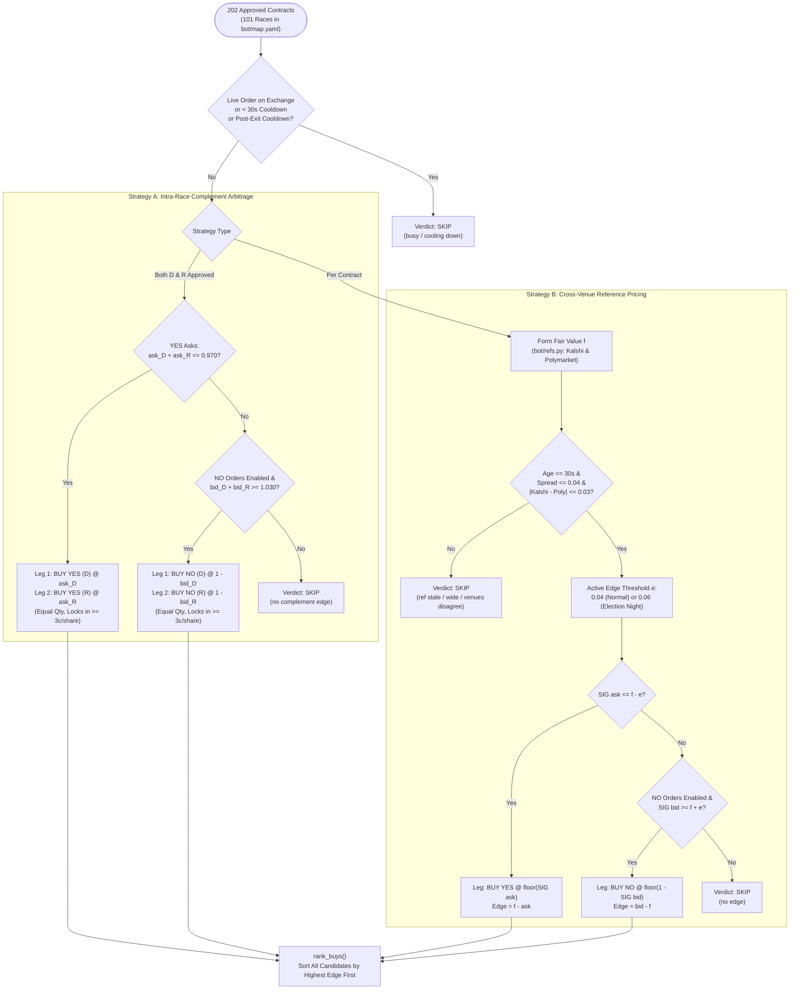
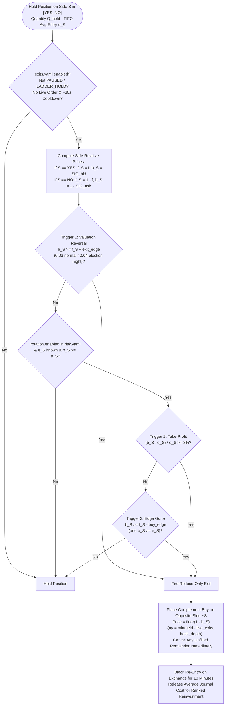
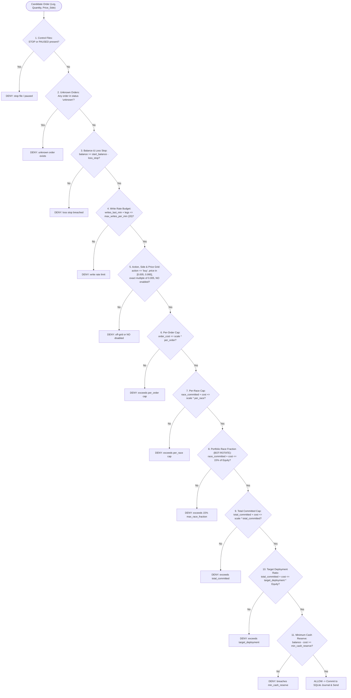

# Bellwether — Quantitative Strategies, Capital Rotation & Risk Gate

> **Scope:** Deep-dive mathematical and algorithmic reference for Bellwether's pricing strategies (`bot/strategy.py`), cross-venue reference fair-value formation (`bot/refs.py`), reduce-only position rotation (`bot/exits.py`, `BOT-ROTATE`), and the 12-stage fail-closed risk gate (`bot/risk.py`).

**Related specifications:**
- [Main README](../README.md) · [System Architecture & Execution Lifecycle](ARCHITECTURE.md)
- [Approved Contract Map Report (`bot/map_all_report.md`)](../bot/map_all_report.md) · [Formal R1 Mapping Criteria (`markets/README.md`)](../markets/README.md)

---

## 1. Price Grid & Buy-Only Execution Invariant

All contract prices on SIG's Super Market settle to **$1.00** (if the outcome occurs) or **$0.00** (otherwise), quoted on a strict **$0.005** tick grid in $[0.005, 0.995]$.
- **Exact `Decimal` Arithmetic:** Every wire price, book level, and cost is decoded and stored as a Python `Decimal` (`engine/sig_client/wire.py`), eliminating IEEE-754 floating-point drift (e.g., `0.535` never becomes `0.5349999999999999`).
- **Conservative Grid Snapping:** Every buy limit price $p$ is snapped **down** (floored) to the nearest $0.005$ tick:
  $$p_{\text{grid}} = \left\lfloor \frac{p}{0.005} \right\rfloor \times 0.005$$
- **Why Bellwether Never Sends `action="sell"`:** On prediction market order books, an oversized sell order (or a duplicate sell after a retry) can cross zero and silently open a short/opposite position. Bellwether enforces `action == "buy"` across the entire codebase (`bot/orders.py`). Even position exits are executed as **complement buys** on the opposite side (`YES` buy to close `NO`; `NO` buy to close `YES`), which SIG's clearing engine nets directly against the held position.

---

## 2. Entry Strategies (`bot/strategy.py`)

### 2.1 Strategy A — Intra-Race Complement Arbitrage (`evaluate_complement`)
In a two-party race where both the Democratic (`D`) and Republican (`R`) contracts are approved and mutually exclusive:
- **Long YES Complement:** If the best asks on SIG satisfy:
  $$\text{ask}_D + \text{ask}_R \le \text{max\_sum\_ask} \quad (0.970)$$
  buying equal quantities $Q$ of `YES` on both `D` and `R` costs $Q \times (\text{ask}_D + \text{ask}_R) \le 0.970 Q$ while paying out $1.000 Q$ whenever either `D` or `R` wins.
- **Long NO Complement:** When `no_orders_enabled: true`, if the best bids on SIG satisfy:
  $$\text{bid}_D + \text{bid}_R \ge \text{min\_sum\_bid} \quad (1.030)$$
  the implied `NO` asks are $(1 - \text{bid}_D)$ and $(1 - \text{bid}_R)$, whose sum is $2 - (\text{bid}_D + \text{bid}_R) \le 0.970$. Buying equal quantities of `NO` on both `D` and `R` locks in at least $0.030$ per share.

### 2.2 Strategy B — Cross-Venue Reference Pricing (`evaluate_reference` & `bot/refs.py`)
Kalshi and Polymarket trade real-money contracts on the same US midterm elections. For each mapped contract, `bot/refs.py` computes a clean reference fair value $f \in (0, 1)$:
1. **Per-Venue Filtering:** A venue quote is accepted only if its timestamp is fresh ($\text{age} \le 30\text{s}$), $0 \le \text{bid} \le \text{ask} \le 1$, and its bid-ask spread is tight ($\text{ask} - \text{bid} \le 0.04$). Its midpoint is $m_v = (\text{bid}_v + \text{ask}_v)/2$.
2. **Cross-Venue Disagreement Check:** When both Kalshi and Polymarket have valid quotes, if $|m_{\text{Kalshi}} - m_{\text{Poly}}| > 0.03$, the contract is **skipped** (`venues disagree`). Otherwise $f = (m_{\text{Kalshi}} + m_{\text{Poly}})/2$ (or the single valid venue's midpoint when only one venue lists the contract).
3. **Regime-Aware Edge Threshold:** Before `election_night_from_utc` (`2026-11-03T23:00:00Z` / `04:30 IST Nov 4`), the required edge is $e = 0.04$ ($4\text{¢}$). Once polls begin closing on election night, adverse selection risk rises and the required edge automatically widens to $e = 0.06$ ($6\text{¢}$).
4. **Signal Generation:**
   - **Buy YES:** When $\text{SIG}_{\text{ask}} \le f - e$, buy `YES` at $\lfloor \text{SIG}_{\text{ask}} \rfloor_{\text{grid}}$.
   - **Buy NO:** When $\text{SIG}_{\text{bid}} \ge f + e$, buy `NO` at $\lfloor 1 - \text{SIG}_{\text{bid}} \rfloor_{\text{grid}}$ (equivalent to selling `YES` at $\text{SIG}_{\text{bid}}$).

---

## 3. Capital Rotation & Reduce-Only Exits (`BOT-ROTATE` & `BOT-EW-5`)

Once the portfolio approaches full deployment, capital rotation (`bot/strategy.py`, `bot/exits.py`) recycles capital out of positions whose edge has been captured or whose fair value has reversed, reinvesting into higher-edge opportunities.

###Three Exit Triggers (`evaluate_exit`)
Let $S \in \{\text{YES}, \text{NO}\}$ be the held side, $f_S$ be the reference fair value for side $S$ ($f$ for `YES`, $1 - f$ for `NO`), $b_S$ be SIG's best bid for side $S$ ($\text{SIG}_{\text{bid}}$ for `YES`, $1 - \text{SIG}_{\text{ask}}$ for `NO`), and $e_S$ be the FIFO average entry price of the currently held shares from the order journal (`risk.entry_price`):
1. **Valuation Reversal Exit (`BOT-EW-5`):** Fires when SIG's bid exceeds reference fair value by at least `exit_edge` ($0.03$ normal, $0.04$ election night):
   $$b_S \ge f_S + \text{exit\_edge}$$
2. **Take-Profit Exit (`BOT-ROTATE`):** Fires when the unrealized percentage gain on the position reaches `take_profit_pct` ($8\%$):
   $$\frac{b_S - e_S}{e_S} \ge 0.08$$
3. **Edge-Gone Exit (`BOT-ROTATE`):** Fires when the market has converged toward fair value so that the entry discount has disappeared ($b_S \ge f_S - \text{buy\_edge}$), **subject to the strict floor $b_S \ge e_S$** (never realizes a loss under `edge_gone`).

---

## 4. The 12-Stage Fail-Closed Risk Gate (`bot/risk.py`)

Every order (`risk.check` for entries, `risk.check_exit` for exits) must pass all applicable checks in `bot/risk.py` before reaching `OrderPath`.

### Key Accounting Rules in `bot/risk.py`
- **Worst-Case Commitment Accounting (`committed`):** `total_committed` and `race_committed` include filled shares (`total_cost`), resting open orders (`price_side * remaining_qty`), **and `unknown` orders at 100% of their full notional size**, plus `preexisting_committed` from manual trading.
- **Exit Commitment Release (`exit_commitments`):** When a reduce-only exit fills, it releases the **FIFO average journal entry cost** of the closed shares (not the exit proceeds), ensuring realized gains or losses never distort the remaining cost basis.
- **Automatic Size Scaling (`joint_quantity` / `allowed_quantity`):** If a candidate order's book-depth size exceeds any cap (per-order, per-race, 15% race fraction, total committed, target deployment, or cash reserve), `bot/strategy.py` automatically scales the share quantity down to the largest integer $Q \ge 1$ that passes `risk.check`.
